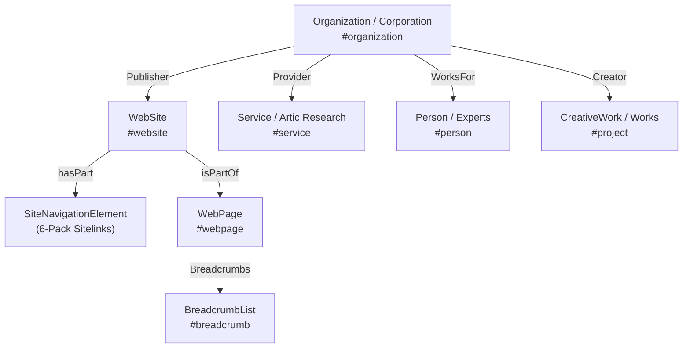
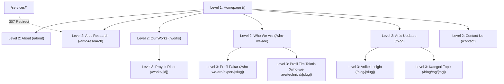

# 🌐 Blueprint & Strategi Penyesuaian SEO Artic Analytica (Entity-First & 6-Pack Sitelinks)

> **Standar Penerapan:** Mengacu pada metodologi arsitektur SEO enterprise yang diterapkan di **Arsalynk** dan **Kaluna Technology**.  
> **Prinsip Utama:** Disesuaikan **100% tanpa mengubah desain visual apapun** (*Zero UI Impact*), bekerja murni pada lapisan struktural data Googlebot (`schema.org` JSON-LD, Metadata API Next.js, Semantic Navigation Hierarchy, Canonicalization, dan OpenGraph).

---

## 🎯 1. Target Tampilan SERP (Google Search Result)

Tujuan utama dari strategi ini adalah mendominasi halaman pertama saat pengguna mencari keyword brand seperti **"Artic Analytica"**, **"Artic Research"**, atau **"Artic Consulting"** dengan tampilan **Expanded 6-Pack Sitelinks**:

```text
+---------------------------------------------------------------------------------------+
|  🌐 Artic Analytica  https://articanalytica.com                                       |
|  Artic Analytica | Where Data Meets Strategy                                          |
|  Firma riset dan konsultasi strategis multidisiplin. Kami membantu pemerintah,       |
|  korporasi, dan organisasi mengambil keputusan berbasis data terukur dan berdampak.   |
|                                                                                       |
|  About Artic                            Our Works                                     |
|  Mengenal profil, visi, & pendekatan... Eksplorasi portofolio proyek riset publik...  |
|                                                                                       |
|  Artic Research                         Who We Are                                    |
|  Layanan survei kepuasan masyarakat...  Profil pakar kebijakan, konsultan & analis... |
|                                                                                       |
|  Artic Updates                          Contact Us                                    |
|  Artikel riset, studi kasus kebijakan.. Konsultasikan kebutuhan riset data Anda...    |
+---------------------------------------------------------------------------------------+
|  KNOWLEDGE PANEL (Sisi Kanan Desktop / Bagian Atas Mobile)                            |
|  [Logo Artic Analytica]                                                               |
|  Artic Analytica                                                                      |
|  Firma Riset & Konsultasi Strategis di Semarang & Jakarta                             |
|  Kantor: MG Setos 3rd Floor, Semarang Tengah, Jawa Tengah                             |
|  Kontak: +62 811-2889-2244 | corporate.articanalytica@gmail.com                       |
|  Profil Media Sosial: LinkedIn | Instagram | Facebook | Twitter/X                     |
+---------------------------------------------------------------------------------------+
```

---

## 🏗️ 2. Arsitektur 6-Pack Sitelinks & Skema JSON-LD

Google menampilkan sitelink berdasarkan kombinasi **popularitas tautan internal**, **hierarki navigasi yang jelas**, dan **deklarasi skema eksplisit**:

### 2.1 6 Pilar Sitelinks Artic Analytica
Setiap entri navigasi dikonfigurasi dengan ringkasan padat (**110–140 karakter**) agar snippet dua baris di Google tidak terpotong (`...`):

1. **About Artic** (`/about`)  
   *Deskripsi:* Mengenal profil, visi, dan pendekatan multidisiplin Artic Analytica dalam mentransformasi data menjadi keputusan strategis berdampak nyata.
2. **Our Works** (`/works`)  
   *Deskripsi:* Eksplorasi portofolio proyek riset persepsi publik, visualisasi data, dan konsultasi strategis bersama instansi pemerintah serta korporasi.
3. **Artic Research** (`/artic-research`)  
   *Deskripsi:* Layanan riset opini publik, survei kepuasan masyarakat, market intelligence, dan analisis kebutuhan audiens yang mendalam dan terukur.
4. **Who We Are** (`/who-we-are`)  
   *Deskripsi:* Profil para pakar kebijakan publik, analis data statistik, konsultan strategis, dan tim teknis profesional di balik Artic Analytica.
5. **Artic Updates** (`/blog`)  
   *Deskripsi:* Kumpulan artikel riset, studi kasus kebijakan publik, wawasan data analytics, dan publikasi tren terbaru dari analis Artic Analytica.
6. **Contact Us** (`/contact`)  
   *Deskripsi:* Konsultasikan kebutuhan riset data, evaluasi kebijakan, atau kemitraan strategis bersama tim ahli Artic Analytica di Semarang dan Jakarta.

---

### 2.2 Hirarki Entity-First Schema Graph (`@id` Berantai)

Seluruh skema terhubung menggunakan `@id` URI permanen sehingga robot Google memahami hubungan relasional antar entitas secara utuh:



1. **`Organization` & `Corporation` (Entity Root - `#organization`):**
   - Berisi legal identity (`PT Sinergi Muda Arsa`), founder (`Rian Destianto`), tahun pendirian (`2024`), logo resmi, email, WhatsApp Business (+62 811-2889-2244), koordinat fisik Semarang (MG Setos), area cakupan (`ID`, `Global`), dan link media sosial (`sameAs`).
2. **`WebSite` (`#website`):**
   - Menghubungkan situs dengan entitas `Organization` sebagai penerbit resmi dan mendeklarasikan array `hasPart` yang memetakan 6 rute utama.
   - **Google Sitelinks SearchBox (Apple.com Technical SEO Standard):** Dilengkapi `potentialAction: SearchAction` mengarah ke query endpoint `articanalytica.com/blog?q={search_term_string}` untuk memicu kotak pencarian langsung di SERP Google.
3. **`SiteNavigationElement` (Direct Sitelinks Trigger):**
   - 6 entri skema eksplisit untuk mengarahkan algoritma sitelinks Google (About Artic, Our Works, Artic Research, Who We Are, Artic Updates, Contact Us).
4. **Apple Web App & Mobile Standards:**
   - Meta tag `apple-mobile-web-app-capable`, `apple-mobile-web-app-status-bar-style: black-translucent`, `apple-mobile-web-app-title: Artic Analytica`, dan `format-detection: telephone=no`.
5. **High-Intent Keyword Matrix per Page:**
   - Homepage: Brand authority, firma riset data terukur, konsultan survei kebijakan.
   - `/about`: Profil multidisiplin, visi misi, evidence-based policy advisory.
   - `/artic-research`: Survei kepuasan masyarakat (IKM), opini publik, market research.
   - `/works`: Portofolio studi kasus BRIDA Semarang, daya saing ekspor, business plan.
   - `/who-we-are`: Pakar kebijakan publik, pakar ilmu pemerintahan UNDIP, analis data.
   - `/blog`: Wawasan data analytics, ISO 9001 data consulting, visualisasi data.
   - `/contact`: Konsultasi riset Semarang Jakarta, proposal survei, kontak resmi.
6. **`BreadcrumbList` (`#breadcrumb`):**
   - Dihasilkan secara otomatis di seluruh sub-halaman (`/about`, `/works`, `/works/[id]`, `/who-we-are`, `/who-we-are/expert/[slug]`, `/who-we-are/technical/[slug]`, `/artic-research`, `/contact`, `/blog`, `/blog/[slug]`, `/blog/tag/[tag]`).
7. **Skema Spesifik Halaman:**
   - `/about`: `AboutPage`
   - `/works`: `CollectionPage`
   - `/works/[id]`: `CreativeWork`
   - `/artic-research`: `ItemPage` + `Service`
   - `/who-we-are`: `AboutPage`
   - `/who-we-are/expert/[slug]`: `Person` + `ProfilePage`
   - `/who-we-are/technical/[slug]`: `Person` + `ProfilePage`
   - `/blog`: `Blog`
   - `/blog/[slug]`: `BlogPosting`
   - `/blog/tag/[tag]`: `CollectionPage`
   - `/contact`: `ContactPage`

---

### 2.3 Hierarki Website 3-Tier Enterprise

Arsitektur informasi situs ditata dengan struktur berjenjang yang bersih tanpa tautan buntu (zero 404):



---

### 2.4 Struktur Hierarki Manajemen Perusahaan

Dalam skema `Organization` Knowledge Graph, struktur manajemen PT Sinergi Muda Arsa didefinisikan secara hierarkis:

1. **Executive Leadership / C-Level:**
   - **Rian Destianto** — *Chief Executive Officer & Founder*
2. **Academic & Policy Advisory Board (Dewan Pakar Senior):**
   - **Drs. Yuwanto, M.Si, P.hD.** — *Political Science & Government Senior Expert*
   - **Huntal Hutapea, S.A.P., M.Si., M.Ed.** — *Public Policy Senior Expert*
   - **Enar Ratriany Assa, SIP., MH** — *Political & Government Legal Expert*
   - **Ayunina Zenti, S.P., M.Sc.** — *Management & Agribusiness Expert*
   - **Fitria Barokah, S.IP., M.IP.** — *Political Science Expert*
3. **Data Analytics & Research Operations:**
   - Tim Analis Data & Lead Enumerator (Arof Fuddin, M. Noorman Perdana, Jonathan Benjamin, Ponco Adi Nugroho, dll.)

---

## 🔍 3. Checklist Verifikasi & Langkah Pasca-Deploy (GSC)

Skema di atas sudah terpasang rapi di kode program. Setelah website di-deploy ke domain produksi live:

1. **Verifikasi Google Search Console (GSC):**
   - Buka [Google Search Console](https://search.google.com/search-console).
   - Masukkan domain (misalnya `articanalytica.com`) via verifikasi DNS TXT record atau set variabel `GOOGLE_SITE_VERIFICATION` di environment hosting (Vercel / cPanel / VPS).
2. **Submit Sitemap:**
   - Masuk ke menu **Sitemaps** di GSC dan submit:
     ```text
     https://articanalytica.com/sitemap.xml
     ```
3. **URL Inspection & Request Indexing:**
   - Jalankan *URL Inspection* pada homepage `/`, `/about`, `/works`, `/artic-research`, `/who-we-are`, `/blog`, dan `/contact`.
   - Klik **Request Indexing**.
4. **Tes Validasi Rich Results Google:**
   - Uji URL di [Google Rich Results Test](https://search.google.com/test/rich-results) untuk memastikan tidak ada warning atau error pada skema `Organization`, `WebSite`, `BreadcrumbList`, dan `SiteNavigationElement`.
5. **Konsistensi NAP & Google Business Profile (GBP):**
   - Pastikan nama, alamat (MG Setos Lt. 3 Semarang), dan nomor telepon (+62 811-2889-2244) terdaftar identik di Google Business Profile, LinkedIn Company Page, dan bio Instagram `@artic.analytica`.
